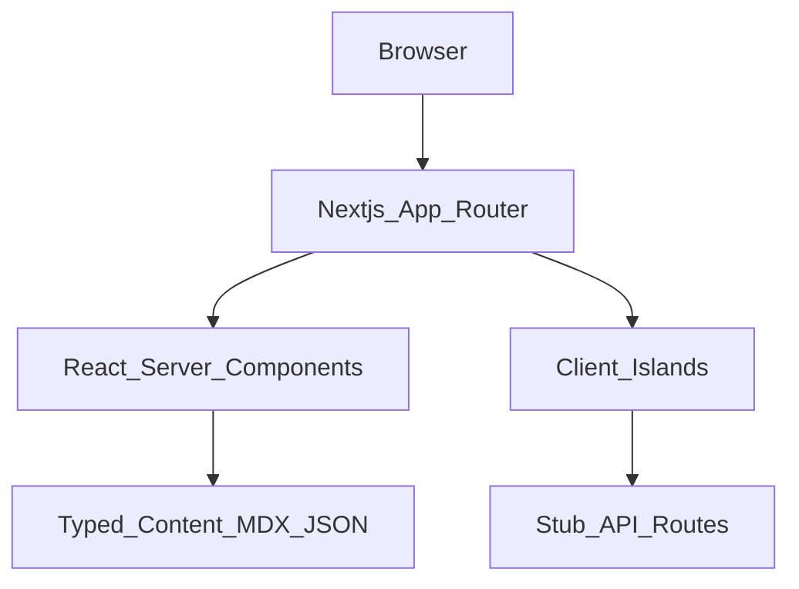
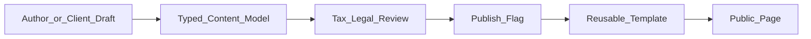
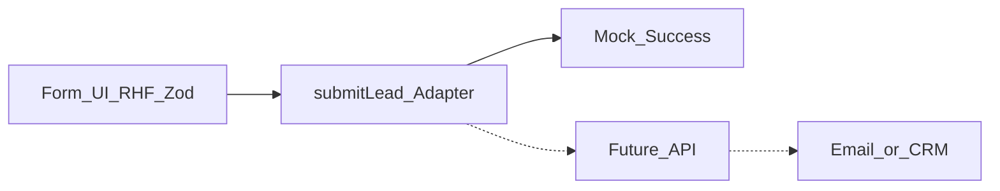
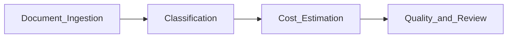
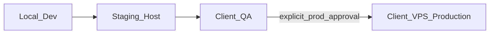

# ARCHITECTURE_DIAGRAMS — CostSeg SI

## 1. Product pillars (frontend scope)

```mermaid
flowchart TD
  root[CostSeg_SI_Website]
  root --> marketing[Marketing_Website]
  root --> hub[Knowledge_Hub]
  root --> tools[Interactive_Tools]
  root --> ui[Shared_UI_System]

  marketing --> m1[Home_Services]
  marketing --> m2[How_It_Works]
  marketing --> m3[Technology_Vision]
  marketing --> m4[Contact_Get_Started]

  hub --> h1[Tax_Laws_IRS]
  hub --> h2[Property_Guides]
  hub --> h3[Assets_CaseStudies]
  hub --> h4[Search_Filters_Related]
  hub --> h5[Future_CMS_API]

  tools --> t1[Questionnaire]
  tools --> t2[Workflow_Explorer]
  tools --> t3[Calculator_Optional]
  tools --> t4[Future_Backend_Services]

  ui --> u1[Design_Tokens_Components]
  ui --> u2[Responsive_Nav_BottomNav]
  ui --> u3[Loaders_Skeletons]
  ui --> u4[Accessibility_SEO]
```

## 2. Frontend runtime structure

## 3. Content flow (knowledge hub)

Unreviewed content must remain `reviewStatus: draft` / not linked for indexing.

## 4. Lead form — present vs future

## 5. Super Intelligence presentation (marketing, not live ops)

Label UI as explanatory / proposed multi-agent workflow unless client confirms operational status.

## 6. Deployment boundary

Production deploy requires **separate explicit approval** beyond Phase 9 staging.
