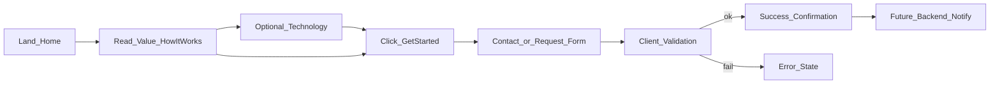
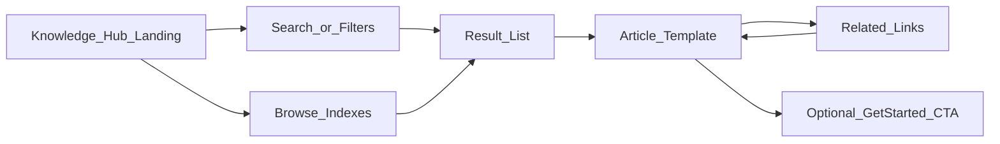

# USER_FLOWS — CostSeg SI

## Flow 1 — Service inquiry (primary conversion)

**Pages:** Home, How It Works, Services, Technology, Contact / Request Study  
**CTA:** Get Started / Discuss Your Property  
**Form fields (proposed):** name, email, phone, property type/address (if approved), message  
**Current frontend:** mock success; no real delivery until destination approved

## Flow 2 — Knowledge search and browse

**Groups:** B–H via reusable templates  
**Filters (proposed):** content type, property type, asset category, citation/topic  
**Note:** Full-text search backend is future; Phase 6 can ship client-side filter over sample content

## Flow 3 — Article reading

1. Enter from hub, search, related link, or SEO landing  
2. Read breadcrumb + title + summary + body  
3. View sources / citations / review status  
4. Follow related content  
5. Optional lead CTA in sidebar or footer of article

## Flow 4 — Interactive tools

### 4a Property questionnaire (priority)

Landing → multi-step or single form (property type, acquisition/construction, dates, contact) → validation → success → (future) lead handoff

### 4b SI workflow explorer (proposed)

Technology page → interactive step visualization (ingestion → classification → estimation → QA/review) → CTA to Get Started  
Must label as explanatory / proposed capability, not live agent dashboard unless confirmed

### 4c Calculator (optional)

Only after methodology approval → inputs → illustrative outputs + strong disclaimers → CTA

## Flow 5 — Mobile app-like navigation

Bottom nav (proposed): Home · Research · Tools · Contact  

- Hidden on desktop/tablet at documented breakpoint  
- Respects safe-area insets  
- Never obscures forms or primary CTAs (page bottom padding)  
